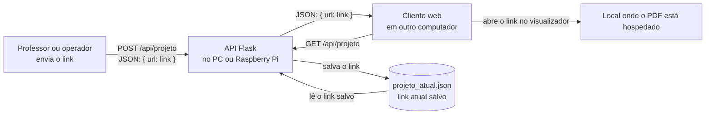

# Diagrama da API — v1

**Equipe:** Software / API  
**Versão:** v1  
**Objetivo:** compartilhar o link de um projeto PDF com o cliente que o exibe em outro computador.

## Como funciona

1. O professor envia à API uma requisição `POST /api/projeto` com o link do PDF em JSON.
2. A API valida o endereço e salva o link em `projeto_atual.json`.
3. O cliente no outro computador consulta `GET /api/projeto` e recebe o link em JSON.
4. O cliente abre esse link no visualizador de PDF.

## Condições e ponto a confirmar

- Durante o teste, os computadores precisam alcançar a API pela rede. O cliente usa o IP do computador que roda a API; `localhost` só aponta para o próprio computador.
- O link do PDF precisa ser acessível pelo computador que vai exibi-lo e permitir sua abertura no navegador.
- **A confirmar:** onde o PDF ficará hospedado (site, armazenamento da escola ou servidor local).
